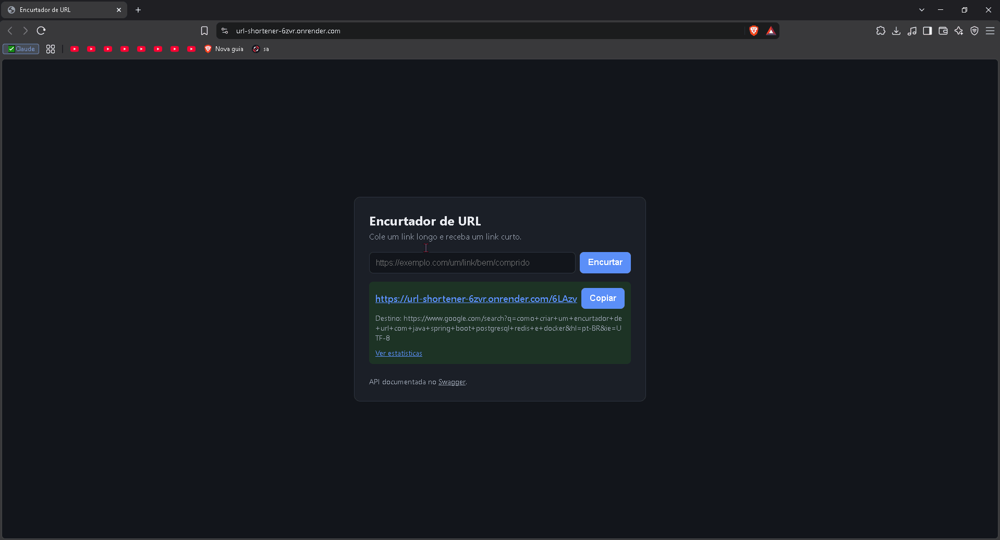

# URL Shortener

Encurtador de URLs feito com **Spring Boot 4**, **PostgreSQL** e **Redis**: cria links curtos, redireciona contando os cliques, mostra estatísticas dos últimos 7 dias e limita quantos links cada IP pode criar por minuto.

Projeto de portfólio, construído em etapas, com foco em decisões técnicas explicáveis e testes automatizados.

**🔗 Projeto no ar:** https://url-shortener-6zvr.onrender.com

**📖 Documentação da API (Swagger):** https://url-shortener-6zvr.onrender.com/swagger-ui.html



> ⏳ **O primeiro acesso pode levar cerca de 1 minuto.** O projeto está no plano gratuito do Render, que "coloca o serviço para dormir" depois de um tempo sem acessos. A primeira visita acorda o serviço; depois disso, as respostas são rápidas.

## Funcionalidades

- **Encurtar URLs:** `POST /api/links` devolve um código curto em Base62 (ex.: `6LAzf`).
- **Redirecionar:** `GET /{code}` responde `302` para a URL original e registra o clique.
- **Cache de redirecionamento:** Redis no padrão *cache-aside*, com TTL de 24h.
- **Estatísticas:** total de cliques e cliques por dia nos últimos 7 dias, incluindo os dias sem clique, com 0.
- **Rate limit:** 10 criações de link por minuto por IP. Acima disso, a resposta é `429` com `Retry-After`.
- **Página web** para encurtar pelo navegador, com botão de copiar.
- **Página de estatísticas** (`/stats.html?code=...`) com o total de cliques e um gráfico de barras dos últimos 7 dias, em HTML, CSS e JavaScript puros.
- **Documentação interativa** com Swagger (springdoc-openapi).
- **Erros padronizados** no formato ProblemDetail ([RFC 9457](https://www.rfc-editor.org/rfc/rfc9457)).

## Stack

| Camada | Tecnologia |
|---|---|
| Linguagem | Java 21 |
| Framework | Spring Boot 4.1 (Web MVC, Data JPA, Data Redis, Validation) |
| Banco de dados | PostgreSQL 16 + Flyway (migrações versionadas) |
| Cache e rate limit | Redis 7 |
| Documentação da API | springdoc-openapi 3 (Swagger UI) |
| Build | Maven (via Maven Wrapper) |
| Infra local | Docker Compose |
| Testes | JUnit 5, AssertJ, Mockito, MockMvc |

## Arquitetura

```
Cliente ──► LinkController ──► LinkService ──────► LinkRepository ──► PostgreSQL
              │                   │  ▲                ClickRepository
              │                   ▼  │
              │                 LinkCache ─────────────────────────► Redis
              │
              ├─► LinkStatsService ──► ClickRepository (GROUP BY por dia)
              │
   CreateLinkRateLimitInterceptor ──► RateLimiter ─────────────────► Redis
   (antes do POST /api/links)

   ApiExceptionHandler: transforma exceções em respostas ProblemDetail
```

O código é organizado por funcionalidade (`link/`, `ratelimit/`, `config/`), e cada camada tem uma responsabilidade:
- o **controller** traduz HTTP ↔ Java;
- o **service** aplica as regras dentro de transações;
- o **repository** conversa com o banco.

## Como rodar

### Pré-requisitos
- Java 21 (com `JAVA_HOME` configurado)
- Docker e Docker Compose

Não é preciso instalar o Maven: o projeto usa o Maven Wrapper (`mvnw`).

### Passo a passo

```bash
# 1. Suba o PostgreSQL e o Redis
docker compose up -d --wait

# 2. Rode a aplicação (Windows PowerShell: .\mvnw.cmd spring-boot:run)
./mvnw spring-boot:run
```

Depois, abra:
- **Página web:** http://localhost:8080
- **Estatísticas de um link:** http://localhost:8080/stats.html?code=SEU_CODIGO (ou clique em "Ver estatísticas" depois de encurtar)
- **Swagger UI:** http://localhost:8080/swagger-ui.html
- **OpenAPI (JSON):** http://localhost:8080/v3/api-docs

O Flyway cria as tabelas automaticamente na primeira execução.

### Rodando os testes

```bash
./mvnw test
```

Os testes de integração usam o PostgreSQL e o Redis do Docker Compose, então os containers precisam estar rodando. Cada teste desfaz o que gravou no banco (rollback) e apaga as chaves que criou no Redis.

### Variáveis de ambiente

Todas são opcionais: os valores padrão funcionam com o `docker-compose.yml`.

| Variável | Padrão | Descrição |
|---|---|---|
| `DB_HOST` / `DB_PORT` / `DB_NAME` | `localhost` / `5432` / `shortener` | Conexão com o PostgreSQL |
| `DB_USER` / `DB_PASSWORD` | `shortener` / `shortener` | Credenciais do PostgreSQL |
| `DB_SSLMODE` | `prefer` | Modo SSL do PostgreSQL (`require` em bancos na nuvem, como o Neon) |
| `DB_POOL_SIZE` | `5` | Máximo de conexões abertas com o banco |
| `REDIS_HOST` / `REDIS_PORT` | `localhost` / `6379` | Conexão com o Redis |
| `REDIS_USERNAME` / `REDIS_PASSWORD` | vazios | Credenciais do Redis (vazias para o Redis local) |
| `REDIS_SSL` | `false` | Liga o TLS na conexão com o Redis (`true` no Upstash) |
| `REDIS_TIMEOUT` | `500ms` | Tempo máximo de espera por um comando no Redis (vale também para a inicialização da conexão) |
| `REDIS_CONNECT_TIMEOUT` | `3s` | Tempo máximo para abrir a conexão TCP com o Redis |
| `PORT` | — | Porta da aplicação; definida automaticamente por plataformas como o Render |
| `SERVER_PORT` | `8080` | Porta da aplicação, usada quando `PORT` não existe |
| `FORWARD_HEADERS_STRATEGY` | `native` | Como ler o IP real do cliente atrás de proxy (ver Decisões técnicas) |
| `CLIENT_IP_HEADER` | vazio | Cabeçalho confiável com o IP real do cliente (ex.: `CF-Connecting-IP` atrás da Cloudflare) |
| `LOG_CLIENT_IP_HEADERS` | `false` | Diagnóstico temporário: loga os cabeçalhos de IP a cada criação de link |
| `TOMCAT_MAX_THREADS` | `50` | Máximo de threads para atender requisições |
| `APP_BASE_URL` | `http://localhost:8080` | Endereço público usado para montar a URL curta |
| `LINK_CACHE_TTL` | `24h` | Tempo de vida de um link no cache |
| `STATS_ZONE` | `America/Sao_Paulo` | Fuso usado para agrupar os cliques por dia |
| `RATE_LIMIT_MAX_CREATIONS` | `10` | Criações de link permitidas por IP em cada janela |
| `RATE_LIMIT_WINDOW` | `1m` | Tamanho da janela do rate limit |
| `SQL_LOG_LEVEL` | `info` | Use `debug` para ver o SQL executado no log |
| `CACHE_LOG_LEVEL` | `info` | Use `debug` para ver os HIT/MISS do cache no log |
| `RATE_LIMIT_LOG_LEVEL` | `info` | Use `debug` para ver no log qual IP o rate limit está usando |
| `JAVA_TOOL_OPTIONS` | (definida no Dockerfile) | Opções de memória da JVM dentro do contêiner |

## Deploy (Render + Neon + Upstash)

O projeto está pronto para rodar no plano gratuito do **Render** (512 MB de RAM), com o PostgreSQL no **Neon** e o Redis no **Upstash**.

- **[Dockerfile](Dockerfile) multi-stage:** o primeiro estágio compila com o JDK, e a imagem final leva só o JRE e o `.jar`, rodando com um usuário sem privilégios.
- **Memória da JVM ajustada para 512 MB** (`JAVA_TOOL_OPTIONS`): heap de no máximo 50% da RAM, tetos para metaspace, code cache e memória direta, pilhas de thread menores e o coletor de lixo mais econômico (`SerialGC`). Num contêiner limitado a 512 MB, a aplicação usou cerca de 270 MB parada e cerca de 290 MB depois de 800 requisições com 20 em paralelo.
- **Health check:** `GET /actuator/health` responde `{"status":"UP"}`. Só esse endpoint do Actuator fica exposto, sem detalhes. Ele verifica o banco, mas não o Redis: a aplicação funciona sem o Redis, então uma falha nele não deve fazer o Render reiniciar o serviço.
- **Porta:** usa a variável `PORT` que o Render define.

### Passo a passo

1. **Neon:** crie um projeto. No painel *Connect*, desligue *Connection pooling* (conexão direta) e copie host, banco, usuário e senha.
2. **Upstash:** crie um banco Redis, de preferência na mesma região do Render. Copie o endpoint, a porta e a senha.
3. **Render:** crie um *Web Service* a partir deste repositório, com *Runtime: Docker* e o plano *Free*.
   - Em *Health Check Path*, use `/actuator/health`.
   - Configure as variáveis abaixo e faça o deploy.

| Variável | Valor |
|---|---|
| `DB_HOST` | host do Neon (ex.: `ep-xxxx.us-east-2.aws.neon.tech`) |
| `DB_PORT` | `5432` |
| `DB_NAME` | nome do banco no Neon (ex.: `neondb`) |
| `DB_USER` / `DB_PASSWORD` | usuário e senha do Neon |
| `DB_SSLMODE` | `require` |
| `REDIS_HOST` | endpoint do Upstash (ex.: `xxxx.upstash.io`) |
| `REDIS_PORT` | porta do Upstash (normalmente `6379`) |
| `REDIS_USERNAME` | `default` |
| `REDIS_PASSWORD` | senha do Upstash |
| `REDIS_SSL` | `true` |
| `REDIS_TIMEOUT` | `1s` (mais margem para a conexão TLS com o Upstash) |
| `CLIENT_IP_HEADER` | `CF-Connecting-IP` (o Render fica atrás da Cloudflare) |
| `APP_BASE_URL` | URL pública do serviço no Render (ex.: `https://url-shortener-xxxx.onrender.com`) |

O Flyway cria as tabelas no Neon no primeiro start. No log de inicialização, a linha `Conexão com o Redis OK` confirma que o Upstash está acessível; se der erro, a linha seguinte mostra a causa (por exemplo, `WRONGPASS` para senha errada).

## Endpoints

### `POST /api/links`: cria um link curto

```bash
curl -X POST http://localhost:8080/api/links \
  -H "Content-Type: application/json" \
  -d '{"url": "https://github.com/pablotrivellato"}'
```

`201 Created` (com o cabeçalho `Location` apontando para a URL curta):
```json
{
  "code": "6LAzf",
  "shortUrl": "http://localhost:8080/6LAzf",
  "originalUrl": "https://github.com/pablotrivellato",
  "createdAt": "2026-10-23T15:34:24.044308Z"
}
```

Possíveis erros:
- **`400`:** URL ausente, inválida, maior que 2048 caracteres ou sem `http://`/`https://`.
- **`429`:** limite de criações atingido; o cabeçalho `Retry-After` informa quantos segundos esperar.

### `GET /{code}`: redireciona

```bash
curl -i http://localhost:8080/6LAzf
```

Responde `302 Found` com `Location: <url original>` e registra o clique. Se o código não existir, responde `404`.

### `GET /api/links/{code}/stats`: estatísticas

```bash
curl http://localhost:8080/api/links/6LAzf/stats
```

```json
{
  "code": "6LAzf",
  "originalUrl": "https://github.com/pablotrivellato",
  "createdAt": "2026-10-21T14:02:11Z",
  "totalClicks": 5,
  "clicksLast7Days": [
    { "date": "2026-10-17", "clicks": 0 },
    { "date": "2026-10-18", "clicks": 0 },
    { "date": "2026-10-19", "clicks": 0 },
    { "date": "2026-10-20", "clicks": 0 },
    { "date": "2026-10-21", "clicks": 3 },
    { "date": "2026-10-22", "clicks": 0 },
    { "date": "2026-10-23", "clicks": 2 }
  ]
}
```

Se o código não existir, responde `404`.

### Formato dos erros

Todos os erros seguem o formato ProblemDetail:
```json
{
  "title": "Dados inválidos",
  "status": 400,
  "detail": "A requisição contém campos inválidos",
  "instance": "/api/links",
  "errors": { "url": "A URL deve começar com http:// ou https://" }
}
```

## Decisões técnicas

**Código em Base62 a partir do id, com deslocamento.**
- O link é inserido primeiro (sem código), o banco gera o `id`, e o código é calculado a partir dele, tudo na mesma transação.
- Como o id é único, não existe colisão de códigos, então não é preciso gerar códigos aleatórios e verificar repetição.
- Um deslocamento fixo de 100.000.000 faz os códigos já começarem com 5 caracteres, em vez de `1`, `2`, `3`.
- Por isso a coluna `code` aceita `NULL`. No PostgreSQL, o `UNIQUE` permite vários `NULL`.

**Rota de redirecionamento restrita por regex.** `GET /{code:[0-9a-zA-Z]{1,16}}` só aceita códigos Base62. Assim `/favicon.ico`, `/index.html` e `/swagger-ui.html` não caem no redirecionamento.

**`302` em vez de `301`.** O `301` é guardado em cache pelo navegador, e os acessos seguintes nem passariam pelo servidor, então os cliques deixariam de ser contados.

**Contador de cliques atômico.** `UPDATE links SET click_count = click_count + 1` é executado no banco. Ler o valor, somar no Java e gravar de volta perderia cliques simultâneos (*race condition*).

**Schema gerenciado pelo Flyway, não pelo Hibernate.** O Hibernate roda com `ddl-auto: validate`: ele só confere se as entidades batem com o banco e nunca altera o schema.

**Cache-aside implementado manualmente.**
- O `LinkCache` usa o `StringRedisTemplate` em vez do `@Cacheable`, para deixar o padrão explícito e controlar as falhas.
- O valor guardado inclui o `id` do link, para registrar o clique sem um `SELECT` (`getReferenceById`).
- O cache é preenchido apenas na leitura, não na criação do link.

**Redis como otimização, não como dependência.** Se o Redis falhar:
- o cache se comporta como um *miss* e a aplicação segue pelo banco;
- o rate limit libera a requisição (*fail-open*).

O timeout do Redis é curto (500ms) para não travar as requisições.

**Rate limit com janela fixa e script Lua.**
- `INCR` e `PEXPIRE` rodam num único script, de forma atômica. Com dois comandos separados, uma falha entre eles deixaria a chave sem expiração, e o IP ficaria bloqueado para sempre.
- É implementado como `HandlerInterceptor`, separado da regra de negócio.

**IP real do cliente atrás de proxy.**
- Com `server.forward-headers-strategy: native`, o Tomcat (`RemoteIpValve`) troca o IP da conexão pelo IP do cliente informado no `X-Forwarded-For`.
- Ele só confia nesse cabeçalho quando a conexão vem de um IP de rede interna (o proxy), e usa o IP mais à direita que não é de proxy.
- Assim, um cliente não consegue burlar o rate limit mandando um `X-Forwarded-For` falso: o IP inventado fica à esquerda e é ignorado.
- Sem proxy, quem se conecta direto pela internet não é "interno", e o cabeçalho é ignorado.
- **Atrás da Cloudflare (caso do Render),** isso não basta: os servidores da Cloudflare têm IPs públicos, então o Tomcat para neles, e cada requisição parece vir de um IP diferente. Por isso existe o `CLIENT_IP_HEADER=CF-Connecting-IP`: a Cloudflare preenche esse cabeçalho com o IP real e sobrescreve qualquer valor enviado pelo cliente, então ele não pode ser falsificado. O valor ainda é validado como IP antes de virar chave no Redis. Só configure esse cabeçalho quando toda requisição passar obrigatoriamente pela Cloudflare.

**Estatísticas agregadas no banco e no fuso certo.**
- A contagem por dia é feita com `GROUP BY` no PostgreSQL, usando o índice `clicks(link_id, clicked_at)`.
- Os dias, inclusive o início da janela (meia-noite), são calculados no fuso `STATS_ZONE`, e não em UTC.
- Os dias sem clique são completados com 0 no Java (`ClickTimeline.fillMissingDays`).

**Tempo injetável.** O "agora" vem de um `Clock` injetado, e os testes usam um relógio fixo para verificar as datas de forma determinística.

**Configuração por variáveis de ambiente**, com valores padrão (no estilo *12-factor app*). Nenhuma credencial real fica no código.

## Limitações conhecidas

- **Códigos previsíveis:** os códigos são sequenciais (`6LAzf`, `6LAzg`...), então é possível "adivinhar" outros links. Uma solução é embaralhar o id antes de codificar (por exemplo, com uma permutação reversível ou com Hashids/Sqids).
- **Escritas a cada clique:** o cache evita o `SELECT`, mas cada redirecionamento ainda faz um `INSERT` em `clicks` e um `UPDATE` no contador. Com muito tráfego, o ideal seria acumular os cliques (por exemplo, no Redis ou numa fila) e gravar em lote.
- **Redis fora do ar deixa o redirecionamento lento:** cada acesso espera os timeouts de leitura e de escrita no cache (cerca de 1s). Um *circuit breaker* evitaria tentar o Redis por um tempo depois de falhas seguidas.
- **Sem invalidação de cache:** hoje os links nunca mudam nem são apagados. Se surgir um endpoint para editar ou apagar links, ele precisa remover a chave do Redis.
- **Códigos inexistentes não são cacheados:** pedidos repetidos para códigos que não existem sempre vão ao banco (faltaria *negative caching*).
- **Janela fixa no rate limit:** na virada da janela, um IP consegue fazer até 2× o limite em poucos segundos. Uma janela deslizante (*sliding window*) ou um *token bucket* resolveria.
- **Depende da plataforma para o IP real:** o `CF-Connecting-IP` só é confiável enquanto a aplicação estiver acessível apenas pela Cloudflare. Em outra plataforma, é preciso revisar `CLIENT_IP_HEADER` (ou configurar `server.tomcat.remoteip.internal-proxies` com os IPs do proxy). Com `RATE_LIMIT_LOG_LEVEL=debug`, o log mostra qual IP está sendo usado.
- **IPv6:** cada cliente IPv6 costuma ter um bloco enorme de endereços (um /64), e pode trocar de IP para contornar o limite. Uma melhoria seria agrupar os IPv6 pelo prefixo /64.
- **Plano gratuito do Render:** o serviço "dorme" depois de um tempo sem acessos, e o primeiro acesso depois disso pode levar cerca de 1 minuto para acordar.
- **Estatísticas sem autenticação:** qualquer pessoa que souber o código pode ver as estatísticas do link.
- **Testes usam o banco de desenvolvimento:** os testes de integração rodam no PostgreSQL e no Redis do Docker Compose. Com Testcontainers, cada execução teria containers descartáveis.
- **Sem expiração de links:** os links são permanentes.

## Estrutura do projeto

```
src/main/java/com/pablo/shortener/
├── ShortenerApplication.java       # ponto de entrada
├── config/                         # propriedades, erros, Clock, Web MVC, OpenAPI
├── link/                           # entidades, repositórios, services, controller, cache, Base62
└── ratelimit/                      # rate limit por IP com Redis
src/main/resources/
├── application.yml                 # configuração (com variáveis de ambiente)
├── db/migration/V1__init.sql       # schema (Flyway)
└── static/
    ├── index.html                  # página para encurtar links
    └── stats.html                  # página de estatísticas com gráfico
```


Projeto desenvolvido por Pablo Trivellato, estudante de Engenharia de Software na PUCPR.
Contato: github.com/TRIVELLATOO (veja meus outros projetos)
